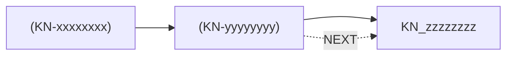

# Stay in the Loop — Project Knowledge

<!-- SITL:VIEW project_id=<PRJ-xxxxxxxx> -->

> Template: `.claude/skills/stay-in-the-loop/templates/KNOWLEDGE_VIEW_TEMPLATE.md`
> Target: `docs/learning/STAY_IN_THE_LOOP.md`
> Role: DERIVED human-facing view. Authority `docs/learning/` state dosyalarıdır. Elle düzenleme.
> Rules: `references/09_KNOWLEDGE_VIEW.md`. Yalnız içerik oluşunca oluşturulur (§2).

<!-- SITL:INDEX:START -->
## Project Home

**Start here:** [Project in 60 Seconds](#project-in-60-seconds) · [Current Position](#where-are-we-now) · [Project Journey](#project-journey)

**Human Sync** — project comprehension

- [<label>](#hs-xxxxxxxx)
- [<label>](#hs-xxxxxxxx) · needs refresh

**Learning** — technical learning. Human Sync ≠ learned.

- [<KN-xxxxxxxx> — <canonical_name>](#kn-xxxxxxxx) · L1 L2

**Knowledge Architecture:** [Knowledge Map](#knowledge-map)

**Open Questions / Learning Debt:** [Open Questions](#what-is-still-unresolved) · [Open Learning Debt](#open-learning-debt)
<!-- SITL:INDEX:END -->

<!-- SITL:MODEL:START -->
## Project in 60 Seconds

#### What are we building?

#### Where are we now?

#### How does it work at the highest level?

#### Five things to remember

#### What is still unresolved?

<strong>Technical Project Snapshot</strong>

#### Architecture

#### Components

#### Active Decisions

#### Invariants

#### Dependencies

<!-- SITL:MODEL:END -->

<!-- SITL:JOURNEY:START -->
## Project Journey

- [<label>](#hs-xxxxxxxx) — <Problem> → <Action> → **<Result>**
  - Revision: [<label>](#hs-xxxxxxxx) — <Problem> → <Action> → **<Result>**
- [<label>](#hs-xxxxxxxx) — <Problem> → <Action> → **<Result>** · **Current position**

Not yet synced: <label>, <label>

[↑ Project Home](#project-home)
<!-- SITL:JOURNEY:END -->

## Human Sync

<!-- SITL:HS:<HS-xxxxxxxx>:START v=<record_version> -->

### <label>

**Status:** <Current | Needs refresh>

**Tek cümlede:** <konu + işlem veya karar + sonuç>

**Anahtar kavramlar:** <basit anlam (Term)> · <basit anlam (Term)>

#### Zihinsel Model

#### Neden Önemli?

<strong>Technical Trace</strong>

#### Why

#### What Changed

#### Key Decisions

#### Dependencies

#### Open Points

#### Evidence

#### More Terms

**Record:** `<HS-xxxxxxxx>` v<record_version> · `<work_unit_id>` · `<checkpoint>`

[↑ Project Home](#project-home)
<!-- SITL:HS:<HS-xxxxxxxx>:END -->

## Learning

<!-- SITL:KN:<KN-xxxxxxxx>:START depth=<L1;L2> -->

### <KN-xxxxxxxx> — <canonical_name>

#### Where am I?

[Project Home](#project-home) → [Knowledge Map](#knowledge-map) → <ROOT> → <parent> → **<canonical_name>**

Parent: <[parent](#kn-xxxxxxxx); parent_id yoksa Yok.>

Reading order — Previous: <NEXT kaynağı> · Next: <NEXT hedefi; NEXT yoksa satır yok>

Also part of: <secondary PART_OF; yoksa satır yok>

**In one sentence:** <graph short_meaning, aynen; boş veya - ise satır yok>

Learning depth: <L1 · L2> · Source: `<event-id>` (`<artifact path>`)

<Local Map: yalnız primary child ≥ 3 ise Mermaid flowchart LR>

#### Semantic Relationships

**Outgoing** (this concept → other concepts):

- **<canonical_name>** — <RELATION> → [<target>](#kn-xxxxxxxx)

**Incoming** (other concepts → this concept):

- [<source>](#kn-xxxxxxxx) — <RELATION> → **<canonical_name>**

#### Recall

- [<önceki hedef>](#kn-xxxxxxxx) — <hedef short_meaning, aynen; capsule yoksa part yok>
  - **Used here:** <edge meaning, aynen> (<REQUIRES | USES | DEPENDS_ON>)

#### Learning Path

L0 → L1 → L2 → L3 (collapsed) → L4 (collapsed) → Boundary (collapsed) → Example → Retrieval → Reference (collapsed)

#### L0 — Map

#### L1 — Simple Mental Model

#### L2 — Mechanism

<strong>L3 — Theory</strong>

<strong>L4 — Formalism</strong>

<strong>Boundary</strong>

#### Example

#### Retrieval

<strong>Reference</strong>

<!-- SITL:KN:<KN-xxxxxxxx>:END -->

<!-- SITL:MAP:START -->
## Knowledge Map

**Legend:** `-->` primary parent · `-- <RELATION> -->` semantic relation, source → target · `-. <RELATION> .->` reading order only, not a dependency

**Concepts:** <root name> (root) · [<canonical_name>](#kn-yyyyyyyy) · <name> (DEBT) · <name> (no section)

**Deeper concepts:** <n> not drawn (map depth <d>, at most <global_map_max_nodes> nodes), by primary parent:

- [<parent>](#kn-yyyyyyyy) → [<child>](#kn-zzzzzzzz) · <child> (no section)

**Relationships:**

- [<source>](#kn-yyyyyyyy) — <RELATION> → [<target>](#kn-zzzzzzzz)

**Reading order** (navigation only, not a dependency):

- [<A>](#kn-yyyyyyyy) → [<B>](#kn-zzzzzzzz)

**Orphan concepts:** <name> (unplaced)

[↑ Project Home](#project-home)
<!-- SITL:MAP:END -->

<!-- SITL:DEBT:START -->
## Open Learning Debt

- `<KD-...>` — <concept> · <priority> · <work_unit_ids>

[↑ Project Home](#project-home)
<!-- SITL:DEBT:END -->
